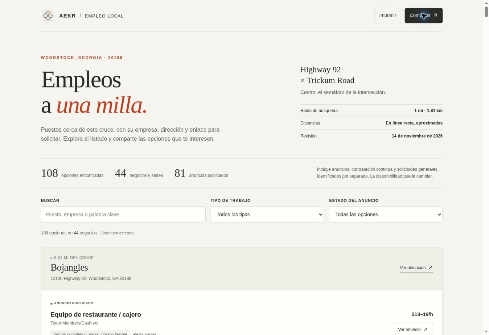

# Empleos a una milla · Woodstock

**[Abrir el listado para compartir](https://woodstock-jobs-aekr.edlopezpm.chatgpt.site/)**

Página estática en español, con estilo AEKR claro, para consultar empleos alrededor
del semáforo de **Highway 92 y Trickum Road, Woodstock, Georgia 30188**.

**Revisión: 14 de noviembre de 2026, America/New_York.** Es una recopilación fechada,
no un servicio que se actualiza automáticamente.

## Contenido

La versión inicial contiene **108 opciones en 44 negocios y sedes**:

| Estado | Registros | Significado |
|---|---:|---|
| Anuncio publicado | 81 | Se encontró una ficha individual o un anuncio específico de la sucursal. No garantiza contratación inmediata. |
| Contratación continua | 4 | La empresa recibe candidatos de manera continua. |
| Por confirmar | 18 | Vigencia, sucursal exacta o detalle del anuncio requieren confirmación. |
| Solicitud general | 5 | Formulario o vía de interés laboral sin una vacante individual confirmada. |

Los registros incluyen título original, descripción breve en español, jornada,
salario cuando el anuncio lo publica, requisitos, observaciones, dirección,
distancia aproximada y enlaces. Los seis departamentos de Walmart que aparecen
como futuras oportunidades se agrupan en un único registro general con sus enlaces.

La página permite buscar por texto, filtrar por tipo de trabajo y estado, abrir
la ubicación, compartir el enlace e imprimir los resultados visibles. El listado
completo y los enlaces también funcionan sin JavaScript.

## Radio y fuentes

El centro es **34.08771251053, -84.484590489643**, el punto central de la intersección
devuelto por el geocodificador público ArcGIS. Las ubicaciones se comprobaron con
direcciones de empleadores, sus coordenadas publicadas, ArcGIS u OpenStreetMap.
Cada ubicación conserva la URL de su fuente en `jobs.json`.

Se utiliza la fórmula de Haversine con radio terrestre de 3,958.7613 millas.
Se incluyen únicamente puntos con distancia calculada **menor o igual a una milla**.
Las distancias son aproximadas, en línea recta, y no equivalen a una ruta a pie.
Los puestos itinerantes, de reparto o con posible asignación a otra sucursal
incluyen una observación; la dirección de la base no limita su recorrido laboral.

Se consultaron portales de empleadores, sistemas públicos de contratación y bolsas
de empleo. Se excluyeron fichas explícitamente vencidas, sucursales fuera del radio
y anuncios sin evidencia suficiente de una ubicación aplicable. `exclusions`
documenta esos descartes y negocios investigados sin anuncio verificable; no
significa que esos negocios nunca contraten. La investigación no garantiza que
abarque todas las contrataciones locales no anunciadas en internet.

Las fichas son resúmenes originales y enlaces a sus fuentes, no reproducciones
completas de las descripciones de empleo. No se presentaron solicitudes ni se
contactó a empleadores.

## Archivos

- `index.html`: página completa y portátil, con CSS, JavaScript e imagen integrados.
- `jobs.json`: datos y fuentes del corte fechado.
- `template.html`: estructura y estilos de la página.
- `build.py`: generador con la biblioteca estándar de Python.
- `preview.jpg`: vista de la página para referencia visual.

Para regenerar desde esta carpeta:

```sh
python build.py
```

El generador incorpora, sin modificarla, la marca AEKR ya existente en
`../weekly-leverage/aekr-mark.png`. El HTML resultante no necesita ese archivo para
abrirse, porque la imagen queda incorporada. No hay dependencias de red para
renderizar el listado, fuentes externas, analítica, cuentas de candidatos ni
formularios que recopilen datos. Los enlaces de contratación llevan a terceros.

## Actualización y publicación

Antes de actualizar, comprobar la fecha y el estado de cada anuncio en su fuente.
Conservar la distinción entre vacantes publicadas, contratación continua,
solicitudes generales y registros pendientes. No convertir rangos estimados por
agregadores en salarios del empleador. Recalcular el radio si cambia una dirección.

Actualizar `jobs.json`, las fechas y los recuentos documentados, ejecutar el
generador, revisar la página y guardar los cambios en este subdirectorio. La copia
web publicada debe coincidir con `index.html` de este repositorio. Un commit en
GitHub por sí solo no actualiza la copia alojada en Sites.

La publicación inicial se comprobó con 108 tarjetas, filtros de búsqueda y estado,
contador de resultados, botón para copiar el enlace, y diseño de 390 y 320 píxeles
sin desborde horizontal. Las 44 distancias se recalcularon en una revisión
independiente. Estas comprobaciones verifican el directorio, no garantizan la
disponibilidad futura de los anuncios de terceros.

Este subproyecto no modifica los modelos FreeCAD ni el proyecto Weekly Leverage.
La marca AEKR conserva sus condiciones de uso existentes.


